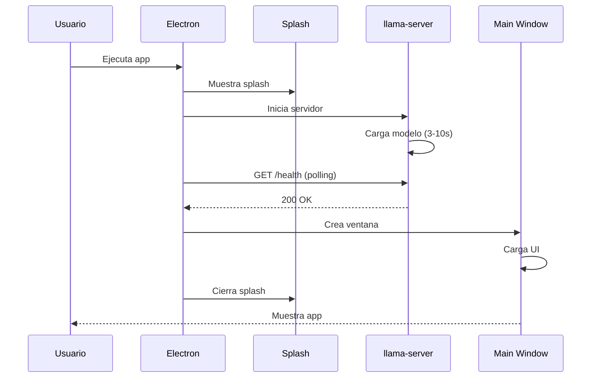

    # Documentación Técnica Completa - LlamaSabIA

> **Proyecto:** LlamaSabIA - IA Offline para Educación  
> **Versión:** 1.0.0  
> **Fecha:** 2026-01-12

---

## 📚 Tabla de Contenidos

1. [Visión General](#visión-general)
2. [Arquitectura del Sistema](#arquitectura-del-sistema)
3. [Módulos Principales](#módulos-principales)
4. [Flujo de Datos](#flujo-de-datos)
5. [Estructura del Proyecto](#estructura-del-proyecto)
6. [Guía de Desarrollo](#guía-de-desarrollo)
7. [API y Especificaciones](#api-y-especificaciones)
8. [Troubleshooting](#troubleshooting)

---

## Visión General

### ¿Qué es LlamaSabIA?

LlamaSabIA es una **aplicación de escritorio educativa** que funciona completamente **offline**, proporcionando acceso a inteligencia artificial para aprendizaje sin necesidad de conexión a internet.

### Características Principales

- ✅ **100% Offline**: Funciona sin internet
- 🔒 **Privacidad Total**: Datos nunca salen de tu computadora
- 🎓 **Cursos Interactivos**: Sistema de aprendizaje con tests
- 🤖 **Asistente IA**: Ayuda contextual durante el aprendizaje
- 💾 **Portable**: Ejecutable desde USB sin instalación

### Stack Tecnológico

```
┌─────────────────────────────────────┐
│  Electron 28.0.0                    │
│  ├─ Chromium (UI)                   │
│  ├─ Node.js (Backend)               │
│  └─ V8 (JavaScript Engine)          │
└─────────────────────────────────────┘
           ↕
┌─────────────────────────────────────┐
│  llama.cpp Server                   │
│  - Puerto 8080                      │
│  - Modelos GGUF                     │
└─────────────────────────────────────┘
           ↕
┌─────────────────────────────────────┐
│  Persistencia                       │
│  - localStorage (Progreso)          │
│  - JSON Files (Cursos)              │
│  - GGUF Files (Modelos IA)          │
└─────────────────────────────────────┘
```

---

## Arquitectura del Sistema

### Arquitectura de Capas

```
┌─────────────────────────────────────────────────────┐
│              CAPA DE PRESENTACIÓN                   │
│  HTML5 + CSS3 + JavaScript ES6+                     │
│  - Chat UI                                          │
│  - Courses UI                                       │
│  - Settings UI                                      │
└─────────────────────────────────────────────────────┘
                        ↕
┌─────────────────────────────────────────────────────┐
│           CAPA DE LÓGICA DE NEGOCIO                 │
│  - CoursesManager (Gestión de progreso)             │
│  - CourseViewer (Renderizado de cursos)             │
│  - Validación de reglas de desbloqueo               │
└─────────────────────────────────────────────────────┘
                        ↕
┌─────────────────────────────────────────────────────┐
│            CAPA DE COMUNICACIÓN                     │
│  - IPC (Inter-Process Communication)                │
│  - Preload.js (Security Bridge)                     │
│  - Context Isolation                                │
└─────────────────────────────────────────────────────┘
                        ↕
┌─────────────────────────────────────────────────────┐
│              CAPA DE SERVICIOS                      │
│  llama.cpp Server (HTTP REST API)                   │
│  - GET /health                                      │
│  - POST /completion                                 │
└─────────────────────────────────────────────────────┘
```

### Componentes Principales

#### 1. Main Process (main.js)
- **Responsabilidad**: Gestión de ventanas y servidor IA
- **Funciones clave**:
  - `startLlamaServer()`: Inicia servidor de IA
  - `createMainWindow()`: Crea ventana principal
  - `checkServerReady()`: Verifica estado del servidor

#### 2. Renderer Process (renderer.js)
- **Responsabilidad**: Interfaz de usuario y chat
- **Funciones clave**:
  - `sendMessage()`: Envía mensajes a la IA
  - `checkServerStatus()`: Actualiza indicador de estado
  - Navegación entre vistas

#### 3. Courses Manager (courses-manager.js)
- **Responsabilidad**: Gestión de progreso del estudiante
- **Funciones clave**:
  - `loadCourse()`: Carga curso desde JSON
  - `isSheetUnlocked()`: Verifica desbloqueo de hojas
  - `saveProgress()`: Guarda progreso en localStorage

#### 4. Course Viewer (course-viewer.js)
- **Responsabilidad**: Renderizado de contenido educativo
- **Funciones clave**:
  - `renderContent()`: Renderiza contenido de lecciones
  - `renderTest()`: Renderiza tests interactivos
  - `checkAnswer()`: Valida respuestas de tests

---

## Módulos Principales

### main.js - Proceso Principal

**Ubicación**: `app/main.js` (208 líneas)

**Flujo de Inicio**:
```javascript
app.whenReady()
  ↓
createSplashWindow()  // Pantalla de carga
  ↓
startLlamaServer()    // Inicia servidor IA
  ↓
checkServerReady()    // Espera hasta 30s
  ↓
createMainWindow()    // Ventana principal
  ↓
mainWindow.show()     // Muestra app
```

**Configuración del Servidor IA**:
```javascript
spawn(serverPath, [
  '-m', modelPath,           // Modelo GGUF
  '--port', '8080',          // Puerto HTTP
  '--ctx-size', '2048',      // Tamaño de contexto
  '--n-gpu-layers', '0',     // Solo CPU
  '--threads', '4'           // Threads de CPU
])
```

### renderer.js - Interfaz de Usuario

**Ubicación**: `app/renderer/renderer.js` (184 líneas)

**Sistema de Navegación**:
```javascript
// Vistas disponibles
- chatView      → Chat con IA
- coursesView   → Sistema de cursos
- aboutView     → Información
- settingsView  → Configuración
```

**Envío de Mensajes a IA**:
```javascript
async function sendMessage() {
  const message = chatInput.value.trim();
  
  // Agregar mensaje del usuario
  addMessage(message, true);
  
  // Enviar a servidor IA
  const response = await fetch('http://127.0.0.1:8080/completion', {
    method: 'POST',
    body: JSON.stringify({
      prompt: `Usuario: ${message}\nAsistente:`,
      temperature: 0.7,
      max_tokens: 512
    })
  });
  
  // Mostrar respuesta
  const data = await response.json();
  addMessage(data.content, false);
}
```

### courses-manager.js - Gestión de Cursos

**Ubicación**: `app/renderer/courses/courses-manager.js` (198 líneas)

**Estructura de Progreso**:
```javascript
{
  "fundamentos-ia": {
    "startedAt": "2026-01-12T10:00:00Z",
    "completedSheets": [
      "fundamentos-ia-1-1",
      "fundamentos-ia-1-2"
    ],
    "scores": {
      "fundamentos-ia-1-2": 90
    },
    "testProgress": {
      "fundamentos-ia-1-4": {
        "currentExercise": 3,
        "answers": [0, 2, 1]
      }
    }
  }
}
```

**Lógica de Desbloqueo**:
```javascript
isSheetUnlocked(chapterId, sheetId) {
  // Primera hoja siempre desbloqueada
  if (sheet.unlocked) return true;
  
  // Tests requieren hoja específica
  if (sheet.type === 'test') {
    return completedSheets.includes(requiredSheet);
  }
  
  // Hojas normales requieren anterior
  return completedSheets.includes(previousSheet);
}
```

### course-viewer.js - Renderizado

**Ubicación**: `app/renderer/courses/course-viewer.js` (541 líneas)

**Tipos de Contenido Soportados**:
- `text`: Texto con Markdown
- `image`: Imágenes con caption
- `warning`: Advertencias (⚠️)
- `info`: Información (💡)
- `success`: Mensajes de éxito (✅)

**Tipos de Ejercicios**:
- `multiple_choice`: Opción múltiple
- `text`: Respuesta de texto libre

---

## Flujo de Datos

### Flujo de Inicio de Aplicación



### Flujo de Chat con IA

```
Usuario escribe mensaje
  ↓
Validar mensaje no vacío
  ↓
Agregar mensaje al DOM
  ↓
Mostrar "Pensando..."
  ↓
POST /completion con prompt
  ↓
Esperar respuesta (2-15s)
  ↓
Parsear JSON response
  ↓
Remover "Pensando..."
  ↓
Agregar respuesta al DOM
  ↓
Auto-scroll al final
```

### Flujo de Tests

```
Cargar test
  ↓
Verificar progreso guardado
  ↓
Renderizar ejercicio actual
  ↓
Usuario responde
  ↓
Validar respuesta
  ↓
┌─────────────┬─────────────┐
│  Correcta   │  Incorrecta │
└─────────────┴─────────────┘
      ↓              ↓
Guardar respuesta  Mostrar error
      ↓              ↓
Siguiente ejercicio  Reintentar
      ↓
¿Último ejercicio?
      ↓
Calcular puntuación
      ↓
Marcar completado
      ↓
Desbloquear siguiente
```

---

## Estructura del Proyecto

### Árbol de Directorios

```
LlamaSabIA/
│
├── app/                      # Aplicación Electron
│   ├── main.js              # Proceso principal (208 líneas)
│   ├── preload.js           # Seguridad (6 líneas)
│   └── renderer/            # UI
│       ├── index.html       # HTML principal
│       ├── renderer.js      # Controlador UI
│       ├── styles.css       # Estilos (2517 líneas)
│       ├── courses/         # Sistema de cursos
│       │   ├── courses-manager.js
│       │   └── course-viewer.js
│       └── data/            # Datos
│           └── courses/     # Cursos JSON
│
├── engine/                  # Motor IA
│   └── llama-server.exe    # Servidor llama.cpp
│
├── models/                  # Modelos IA
│   └── *.gguf              # Archivos GGUF (2-8GB)
│
├── scripts/                 # Utilidades
│   └── download-model.js   # Descargador
│
├── docs/                    # Documentación
│   ├── modulos.md
│   ├── arquitectura.md
│   ├── flujo.md
│   ├── estructura.md
│   └── desarrollo.md
│
└── package.json            # Configuración npm
```

### Archivos Principales

| Archivo | Tamaño | Descripción |
|---------|--------|-------------|
| `app/main.js` | 5 KB | Proceso principal Electron |
| `app/renderer/renderer.js` | 5 KB | Controlador de UI |
| `app/renderer/styles.css` | 47 KB | Sistema de diseño |
| `courses-manager.js` | 6 KB | Gestión de progreso |
| `course-viewer.js` | 20 KB | Renderizado de cursos |

---

## Guía de Desarrollo

### Requisitos del Sistema

**Mínimos**:
- CPU: 4 cores (Intel i5 / Ryzen 3)
- RAM: 8 GB
- Disco: 10 GB libres
- OS: Windows 10 64-bit

**Recomendados**:
- CPU: 8 cores (Intel i7 / Ryzen 7)
- RAM: 16 GB
- Disco: 20 GB libres (SSD)
- OS: Windows 11 64-bit

### Instalación

#### 1. Instalar Node.js
```bash
# Descargar desde https://nodejs.org
# Versión recomendada: 20.x LTS
node --version  # Verificar
```

#### 2. Clonar Repositorio
```bash
git clone https://github.com/tu-usuario/LlamaSabIA.git
cd LlamaSabIA
```

#### 3. Instalar Dependencias
```bash
npm install
```

#### 4. Descargar Modelo IA
```bash
# Modelo pequeño (2.4 GB) - Recomendado
npm run download:model phi3-mini

# Modelo mediano (4.9 GB)
npm run download:model llama3-8b
```

#### 5. Ejecutar Aplicación
```bash
npm start
```

### Scripts Disponibles

```bash
npm start              # Iniciar en desarrollo
npm run build:portable # Crear ejecutable portable
npm run download:model # Descargar modelo IA
```

### Agregar Nuevo Curso

#### 1. Crear JSON del Curso
**Archivo**: `app/renderer/data/courses/nuevo-curso.json`

```json
{
  "id": "nuevo-curso",
  "title": "Título del Curso",
  "description": "Descripción breve",
  "duration": "2 semanas",
  "difficulty": "Intermedio",
  "icon": "📘",
  "chapters": [
    {
      "id": 1,
      "title": "Capítulo 1",
      "sheets": [
        {
          "id": 1,
          "title": "Lección 1",
          "duration": "15 min",
          "type": "content",
          "unlocked": true,
          "content": {
            "sections": [
              {
                "type": "text",
                "content": "# Título\n\nContenido..."
              }
            ]
          }
        }
      ]
    }
  ],
  "aiContext": "Contexto para el asistente IA..."
}
```

#### 2. Agregar a Lista
**Archivo**: `app/renderer/courses/course-viewer.js`

```javascript
showCourseList() {
  this.renderCourseList([
    // ... cursos existentes
    {
      id: 'nuevo-curso',
      title: 'Título del Curso',
      description: 'Descripción breve',
      duration: '2 semanas',
      difficulty: 'Intermedio',
      icon: '📘'
    }
  ]);
}
```

#### 3. Crear Assets
```bash
mkdir app/renderer/assets/nuevo-curso
# Agregar imágenes aquí
```

---

## API y Especificaciones

### API del Servidor llama.cpp

#### Endpoint: Health Check
```http
GET http://127.0.0.1:8080/health
```

**Respuesta**:
```json
{
  "status": "ok"
}
```

#### Endpoint: Completion
```http
POST http://127.0.0.1:8080/completion
Content-Type: application/json
```

**Request**:
```json
{
  "prompt": "Usuario: ¿Qué es una función?\nAsistente:",
  "temperature": 0.7,
  "max_tokens": 512,
  "stop": ["Usuario:", "\n\n"]
}
```

**Response**:
```json
{
  "content": "Una función es una relación matemática...",
  "stop": true,
  "tokens_predicted": 87,
  "tokens_evaluated": 15
}
```

### Parámetros de Configuración

| Parámetro | Valor Default | Descripción |
|-----------|---------------|-------------|
| `temperature` | 0.7 | Creatividad (0.0-2.0) |
| `max_tokens` | 512 | Longitud máxima |
| `stop` | `["Usuario:"]` | Tokens de parada |
| `ctx_size` | 2048 | Tamaño de contexto |
| `threads` | 4 | Threads de CPU |

### Estructura de Datos

#### Curso (JSON)
```javascript
{
  id: string,           // Identificador único
  title: string,        // Título del curso
  chapters: [           // Array de capítulos
    {
      id: number,       // ID del capítulo
      sheets: [         // Array de hojas
        {
          id: number,   // ID de la hoja
          type: "content" | "test",
          content: {...} | exercises: [...]
        }
      ]
    }
  ]
}
```

#### Progreso (localStorage)
```javascript
{
  "course_progress": {
    "course-id": {
      startedAt: string,          // ISO timestamp
      completedSheets: string[],  // IDs completados
      scores: { [key]: number },  // Puntuaciones
      testProgress: { [key]: {...} } // Progreso de tests
    }
  }
}
```

---

## Troubleshooting

### Problemas Comunes

#### 1. Servidor IA no inicia

**Síntomas**: Indicador muestra "Desconectado"

**Soluciones**:
```bash
# Verificar que existe llama-server.exe
dir engine\llama-server.exe

# Verificar que existe modelo
dir models\*.gguf

# Ver logs en terminal
# Buscar errores de llama-server
```

#### 2. Modelo no encontrado

**Síntomas**: Error "No se encontró modelo .gguf"

**Soluciones**:
```bash
# Descargar modelo
npm run download:model phi3-mini

# O colocar manualmente en models/
```

#### 3. Aplicación no inicia

**Síntomas**: Ventana no aparece

**Soluciones**:
```bash
# Reinstalar dependencias
rm -rf node_modules package-lock.json
npm install

# Verificar versión de Node
node --version  # Debe ser >= 18
```

#### 4. Respuestas lentas de IA

**Síntomas**: Tarda > 30s en responder

**Soluciones**:
```javascript
// Reducir max_tokens en renderer.js
max_tokens: 256  // En lugar de 512

// Usar modelo más pequeño
// Phi-3 Mini (2.4GB) en lugar de Llama 3 (4.9GB)
```

### Logs y Debugging

**Ver logs del servidor**:
```bash
# Los logs aparecen en la terminal donde ejecutaste npm start
[LlamaServer]: llama_model_loader: loaded meta data
[LlamaServer]: server: listening on http://127.0.0.1:8080
```

**Abrir DevTools**:
```javascript
// Agregar en main.js después de createMainWindow()
mainWindow.webContents.openDevTools();
```

**Verificar localStorage**:
```javascript
// En DevTools > Console
localStorage.getItem('course_progress')
```

---

## Métricas del Proyecto

### Estadísticas de Código

| Métrica | Valor |
|---------|-------|
| **Líneas de JavaScript** | ~1,300 |
| **Líneas de CSS** | ~2,500 |
| **Líneas de HTML** | ~250 |
| **Archivos principales** | 7 |
| **Tamaño sin modelos** | ~50 MB |
| **Tamaño con modelo** | 2.5-8 GB |

### Rendimiento

| Operación | Tiempo Típico |
|-----------|---------------|
| Inicio de app | 5-10s |
| Carga de curso | < 100ms |
| Respuesta IA (corta) | 2-5s |
| Respuesta IA (larga) | 5-15s |
| Guardado de progreso | < 50ms |

---

## Conclusión

LlamaSabIA es una aplicación educativa robusta que combina:
- ✅ Arquitectura modular y escalable
- ✅ Seguridad mediante context isolation
- ✅ Persistencia local sin base de datos
- ✅ IA offline para privacidad total
- ✅ Sistema de cursos interactivos

Para más información, consultar los documentos detallados en `docs/`.

---

**Documentación creada**: 2026-01-12  
**Versión del proyecto**: 1.0.0  
**Mantenedor**: Equipo LlamaSabIA
