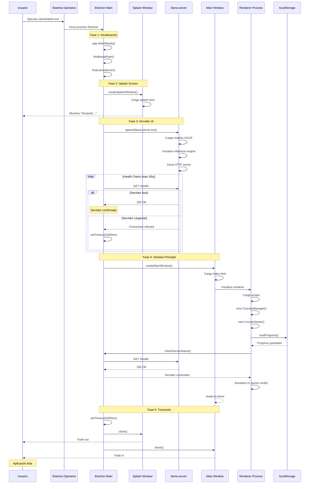
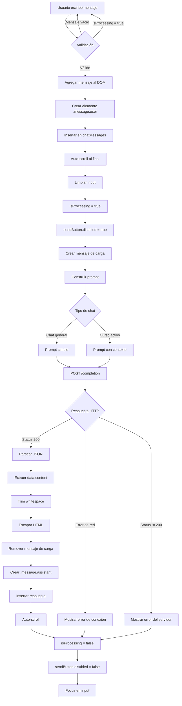
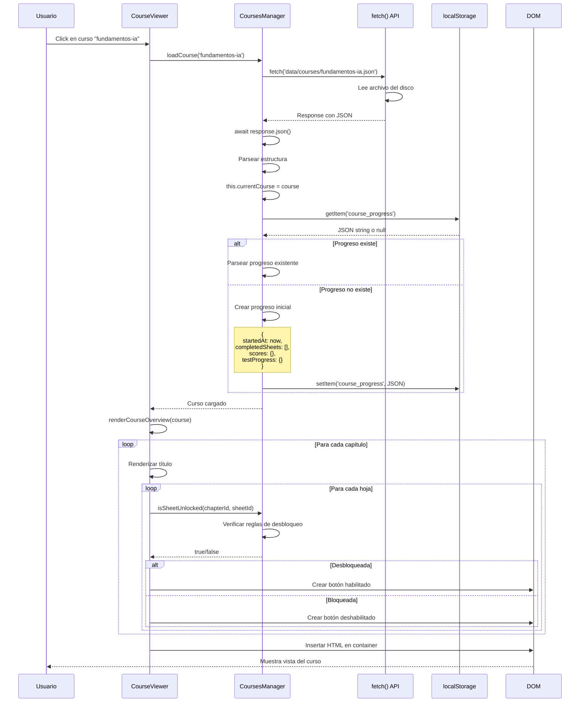
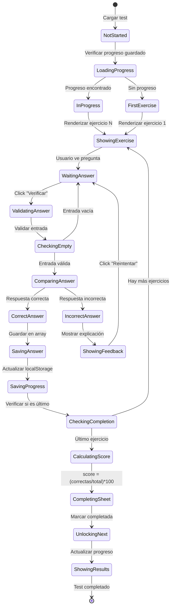

# Documentación Técnica Detallada - Flujo de Datos y Procesos

> **Versión:** 2.0 - Análisis Exhaustivo de Flujos  
> **Última actualización:** 2026-01-12  
> **Nivel de detalle:** Ingeniería de sistemas

## 📑 Índice

1. [Flujo de Inicio de Aplicación](#flujo-de-inicio-de-aplicación)
2. [Flujo de Chat con IA](#flujo-de-chat-con-ia)
3. [Flujo de Gestión de Cursos](#flujo-de-gestión-de-cursos)
4. [Flujo de Tests Interactivos](#flujo-de-tests-interactivos)
5. [Flujo de Persistencia de Datos](#flujo-de-persistencia-de-datos)
6. [Flujo de Manejo de Errores](#flujo-de-manejo-de-errores)
7. [Diagramas de Secuencia Detallados](#diagramas-de-secuencia-detallados)

---

## Flujo de Inicio de Aplicación

### Secuencia Completa de Arranque



### Análisis Temporal del Arranque

| Fase | Duración Típica | Duración Máxima | Actividad Principal |
|------|-----------------|-----------------|---------------------|
| **1. Inicialización** | 100-200ms | 500ms | Electron startup |
| **2. Splash Screen** | 50-100ms | 200ms | Carga HTML/CSS |
| **3. Servidor IA** | 3-10s | 30s | Carga de modelo |
| **4. Ventana Principal** | 200-500ms | 1s | Carga de UI |
| **5. Transición** | 2s | 2s | Animación |
| **TOTAL** | **5.5-13s** | **34s** | Inicio completo |

### Desglose Detallado: Fase 3 (Servidor IA)

**Subprocesos del inicio del servidor**:

```
spawn(llama-server.exe)
  ↓
1. Validación de argumentos (< 10ms)
   - Verifica que modelo existe
   - Valida puerto disponible
   ↓
2. Carga de modelo GGUF (2-8s)
   - Lee archivo binario
   - Parsea metadatos
   - Carga pesos en RAM
   - Cuantización si necesario
   ↓
3. Inicialización de engine (500ms-2s)
   - Configura contexto (ctx_size)
   - Inicializa KV cache
   - Prepara threads
   ↓
4. Inicio de HTTP server (< 100ms)
   - Bind a puerto 8080
   - Registra endpoints
   - Inicia event loop
   ↓
5. Servidor listo
   - Responde a /health con 200
```

**Factores que afectan el tiempo de carga**:

| Factor | Impacto | Ejemplo |
|--------|---------|---------|
| Tamaño del modelo | Alto | Phi-3 (2.4GB): 3s, Llama-3 (4.9GB): 8s |
| Velocidad de disco | Medio | SSD: 3s, HDD: 8s |
| RAM disponible | Bajo | 8GB: 5s, 16GB: 3s |
| CPU | Bajo | 4 cores: 4s, 8 cores: 3s |

### Casos de Error en el Arranque

#### Error 1: Modelo no encontrado

```
findModelPath() → null
  ↓
startLlamaServer() → { success: false, error: "No se encontró modelo" }
  ↓
Aplicación continúa sin IA
  ↓
Usuario ve indicador "Desconectado"
```

**Recuperación**: Usuario debe descargar modelo manualmente.

#### Error 2: Puerto 8080 ocupado

```
spawn(llama-server.exe) → Inicia
  ↓
llama-server intenta bind(8080) → Error: Address in use
  ↓
Proceso termina con código 1
  ↓
checkServerReady() → Timeout después de 30s
  ↓
callback(false)
```

**Recuperación**: Cerrar aplicación que usa puerto 8080 o cambiar puerto en código.

#### Error 3: Modelo corrupto

```
llama-server carga modelo
  ↓
Error al parsear GGUF: "Invalid magic number"
  ↓
Proceso termina con código 1
  ↓
stderr: "error: failed to load model"
```

**Recuperación**: Redescargar modelo.

---

## Flujo de Chat con IA

### Diagrama de Flujo Detallado



### Construcción del Prompt

**Prompt básico** (chat general):
```javascript
{
  prompt: `Usuario: ${message}\nAsistente:`,
  temperature: 0.7,
  max_tokens: 512,
  stop: ["Usuario:", "\n\n"]
}
```

**Prompt con contexto** (desde curso):
```javascript
const context = coursesManager.getAIContext();
{
  prompt: `${context}\n\nEstudiante: ${message}\nAsistente:`,
  temperature: 0.7,
  max_tokens: 300,
  stop: ["Estudiante:", "\n\n"]
}
```

**Ejemplo de contexto generado**:
```
Curso: Fundamentos de Matemática para IA
Capítulo: Introducción al Sprint
Hoja Actual: Plano Cartesiano

Este es un curso de fundamentos de matemática para IA enfocado en funciones de activación. El estudiante está aprendiendo desde cero. Responde dudas de forma pedagógica, con ejemplos simples. NO resuelvas los ejercicios directamente, guía al estudiante para que llegue a la respuesta por sí mismo.

Contenido de la hoja actual:
# Ubicación de Puntos en el Plano Cartesiano

Básicamente, el plano cartesiano está formado por dos rectas numéricas reales que se cruzan formando un ángulo recto...

Estudiante: ¿Qué es el eje de abscisas?
Asistente:
```

### Parámetros de Generación

| Parámetro | Valor | Efecto | Rango Válido |
|-----------|-------|--------|--------------|
| `temperature` | 0.7 | Creatividad moderada | 0.0-2.0 |
| `max_tokens` | 512 | Respuestas medianas | 1-2048 |
| `stop` | `["Usuario:", "\n\n"]` | Detiene en nueva pregunta | Array de strings |
| `top_p` | 0.95 (default) | Nucleus sampling | 0.0-1.0 |
| `top_k` | 40 (default) | Top-k sampling | 1-100 |

**Efecto de temperature**:

```
temperature = 0.0  → Determinista, siempre misma respuesta
temperature = 0.3  → Muy conservador, respuestas predecibles
temperature = 0.7  → Balanceado (RECOMENDADO)
temperature = 1.0  → Creativo, más variedad
temperature = 1.5  → Muy creativo, puede divagar
temperature = 2.0  → Caótico, respuestas impredecibles
```

### Tiempo de Respuesta

**Factores que afectan la latencia**:

1. **Longitud del prompt**: Más tokens = más tiempo
2. **max_tokens**: Más tokens a generar = más tiempo
3. **Modelo**: Modelos más grandes son más lentos
4. **CPU**: Más cores = más rápido
5. **Contexto previo**: Más contexto = más lento

**Tiempos típicos**:

| Escenario | Prompt | max_tokens | Tiempo |
|-----------|--------|------------|--------|
| Pregunta corta | 50 tokens | 100 | 2-3s |
| Pregunta media | 200 tokens | 300 | 5-8s |
| Pregunta larga | 500 tokens | 512 | 10-15s |
| Con contexto curso | 1000 tokens | 300 | 8-12s |

**Cálculo aproximado**:
```
Tiempo ≈ (prompt_tokens + max_tokens) / tokens_per_second

Phi-3 Mini en CPU (4 cores):
- tokens_per_second ≈ 15-25
- Ejemplo: (200 + 300) / 20 = 25 segundos
```

### Manejo de Errores

#### Error de Conexión

```javascript
try {
  const response = await fetch(LLAMA_API, {...});
} catch (error) {
  // Error de red: servidor no responde
  loadingMsg.remove();
  addMessage(
    '⚠️ Error: No se pudo conectar con el servidor de IA. ' +
    'Verifica que llama-server esté ejecutándose.',
    false
  );
}
```

**Causas comunes**:
- Servidor no iniciado
- Servidor crasheó
- Puerto incorrecto
- Firewall bloqueando

#### Error de Servidor

```javascript
if (!response.ok) {
  throw new Error('Error en la respuesta del servidor');
}
```

**Códigos de estado posibles**:
- `400 Bad Request`: Parámetros inválidos
- `500 Internal Server Error`: Error en inferencia
- `503 Service Unavailable`: Servidor sobrecargado

---

## Flujo de Gestión de Cursos

### Carga de Curso



### Lógica de Desbloqueo

**Algoritmo completo**:

```javascript
function isSheetUnlocked(chapterId, sheetId) {
  // Paso 1: Obtener hoja
  const sheet = this.getSheet(chapterId, sheetId);
  if (!sheet) return false;
  
  // Paso 2: Verificar flag de desbloqueo manual
  if (sheet.unlocked === true) {
    return true;  // Primera hoja siempre desbloqueada
  }
  
  // Paso 3: Verificar tipo de hoja
  if (sheet.type === 'test') {
    // Tests requieren completar hoja específica
    if (sheet.requiresCompletion) {
      const requiredSheetId = sheet.requiresCompletion;
      const progressKey = `${this.currentCourse.id}-${chapterId}-${requiredSheetId}`;
      
      // Verificar si la hoja requerida está completada
      return this.progress[this.currentCourse.id]?.completedSheets.includes(progressKey);
    }
  }
  
  // Paso 4: Hojas normales requieren anterior
  const prevSheetId = sheetId - 1;
  const progressKey = `${this.currentCourse.id}-${chapterId}-${prevSheetId}`;
  
  return this.progress[this.currentCourse.id]?.completedSheets.includes(progressKey);
}
```

**Casos de uso**:

1. **Primera hoja** (id=1, unlocked=true):
   ```javascript
   isSheetUnlocked(1, 1) → true  // Siempre desbloqueada
   ```

2. **Segunda hoja** (id=2, type='content'):
   ```javascript
   // Requiere completar hoja 1
   completedSheets.includes('fundamentos-ia-1-1') → true/false
   ```

3. **Test** (id=4, type='test', requiresCompletion=3):
   ```javascript
   // Requiere completar hoja 3 específicamente
   completedSheets.includes('fundamentos-ia-1-3') → true/false
   ```

### Renderizado de Contenido

**Proceso de renderizado**:

```
loadSheet(chapterId, sheetId)
  ↓
getSheet() → Obtiene objeto de hoja
  ↓
Determinar tipo: 'content' o 'test'
  ↓
┌─────────────────┬─────────────────┐
│   type='content'│   type='test'   │
└─────────────────┴─────────────────┘
        ↓                   ↓
renderContent()      renderTest()
        ↓                   ↓
Iterar sections    Cargar progreso
        ↓                   ↓
Aplicar strategy   renderExercise()
        ↓                   ↓
Generar HTML       Generar HTML
        ↓                   ↓
Insertar en DOM    Insertar en DOM
        ↓                   ↓
completeSheet()    Esperar respuestas
```

**Estrategias de renderizado por tipo**:

```javascript
const renderStrategies = {
  'text': (section) => {
    const html = this.parseMarkdown(section.content);
    return `<div class="content-text">${html}</div>`;
  },
  
  'image': (section) => {
    return `
      <figure class="content-image ${section.size || ''}">
        
        ${section.caption ? `<figcaption>${section.caption}</figcaption>` : ''}
      </figure>
    `;
  },
  
  'warning': (section) => {
    return `<div class="content-box warning">⚠️ ${this.parseMarkdown(section.content)}</div>`;
  },
  
  'info': (section) => {
    return `<div class="content-box info">💡 ${this.parseMarkdown(section.content)}</div>`;
  },
  
  'success': (section) => {
    return `<div class="content-box success">✅ ${this.parseMarkdown(section.content)}</div>`;
  }
};
```

---

## Flujo de Tests Interactivos

### Máquina de Estados del Test



### Proceso de Verificación de Respuesta

**Opción múltiple**:

```javascript
function checkAnswer() {
  const exercise = this.currentSheet.exercises[this.currentExerciseIndex];
  const feedback = document.getElementById('exerciseFeedback');
  
  // 1. Obtener selección del usuario
  const selected = document.querySelector('input[name="answer"]:checked');
  
  // 2. Validar que hay selección
  if (!selected) {
    feedback.innerHTML = '<div class="feedback-warning">⚠️ Por favor selecciona una opción</div>';
    return;
  }
  
  // 3. Extraer valor
  const userAnswer = parseInt(selected.value);  // Índice de la opción (0, 1, 2, ...)
  
  // 4. Comparar con respuesta correcta
  const isCorrect = (userAnswer === exercise.correct);
  
  // 5. Generar feedback
  if (isCorrect) {
    this.correctAnswers.push(this.currentExerciseIndex);
    
    const isLastExercise = (this.currentExerciseIndex >= this.currentSheet.exercises.length - 1);
    
    feedback.innerHTML = `
      <div class="feedback-success">
        ✅ ¡Correcto! ${exercise.explanation}
        <button onclick="courseViewer.nextExercise()" class="next-button">
          ${isLastExercise ? 'Finalizar Test ✓' : 'Siguiente Pregunta →'}
        </button>
      </div>
    `;
  } else {
    feedback.innerHTML = `
      <div class="feedback-error">
        ❌ Incorrecto. ${exercise.explanation}
        <button onclick="document.getElementById('exerciseFeedback').innerHTML = ''" class="retry-button">
          Intentar de Nuevo
        </button>
      </div>
    `;
  }
}
```

**Respuesta de texto**:

```javascript
// Obtener input de texto
const textInput = document.getElementById('textAnswer');
const userAnswer = textInput.value.toLowerCase().trim();

// Validar no vacío
if (!userAnswer) {
  feedback.innerHTML = '<div class="feedback-warning">⚠️ Por favor escribe una respuesta</div>';
  return;
}

// Comparar (case-insensitive)
const isCorrect = (userAnswer === exercise.answer.toLowerCase());
```

### Guardado de Progreso Intermedio

**Cuándo se guarda**:

1. **Después de cada respuesta correcta**:
   ```javascript
   nextExercise() {
     this.currentExerciseIndex++;
     
     // Guardar progreso
     coursesManager.saveTestProgress(
       this.currentChapterId,
       this.currentSheetId,
       this.currentExerciseIndex,
       this.correctAnswers
     );
   }
   ```

2. **Estructura guardada**:
   ```javascript
   testProgress[progressKey] = {
     currentExercise: 3,           // Índice del ejercicio actual
     answers: [0, 2, 1],           // Índices de ejercicios correctos
     lastUpdate: "2026-01-12T10:30:00.000Z"
   }
   ```

3. **Restauración al reabrir**:
   ```javascript
   renderTest(sheet, chapterId, sheetId) {
     const testProgress = coursesManager.getTestProgress(chapterId, sheetId);
     
     if (testProgress) {
       this.currentExerciseIndex = testProgress.currentExercise;
       this.correctAnswers = testProgress.answers;
       
       // Mostrar mensaje informativo
       console.log(`Continuando desde pregunta ${testProgress.currentExercise + 1}`);
     } else {
       this.currentExerciseIndex = 0;
       this.correctAnswers = [];
     }
     
     this.renderExercise(sheet.exercises[this.currentExerciseIndex]);
   }
   ```

### Cálculo de Puntuación

```javascript
function calculateScore() {
  const totalExercises = this.currentSheet.exercises.length;
  const correctCount = this.correctAnswers.length;
  
  // Puntuación porcentual
  const score = Math.round((correctCount / totalExercises) * 100);
  
  return score;
}

// Ejemplo:
// Total: 10 ejercicios
// Correctas: 8
// Score: (8 / 10) * 100 = 80%
```

**Completar test**:

```javascript
nextExercise() {
  this.currentExerciseIndex++;
  
  if (this.currentExerciseIndex < totalExercises) {
    // Renderizar siguiente ejercicio
    this.renderExercise(this.currentSheet.exercises[this.currentExerciseIndex]);
  } else {
    // Test completado
    const score = this.calculateScore();
    
    // Marcar hoja como completada
    coursesManager.completeSheet(this.currentChapterId, this.currentSheetId, score);
    
    // Mostrar resultados
    this.showCompletionMessage(score);
  }
}
```

---

**Continuaré con las secciones restantes en archivos adicionales...**
